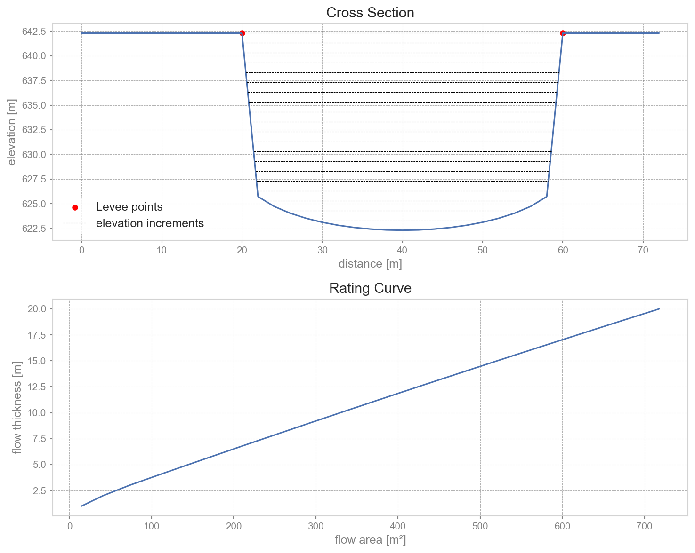

in2DFHyd: Initial Hydraulic Conditions Module
================================================

:py:mod:`in2DFHyd` is a module for deriving initial hydraulic conditions for the :py:mod:`c1TIF` computation module
for a debris-flow hydrograph at a prescribed release line. The module combines the terrain :term:`cross section` geometry with
a :term:`debris-flow hydrograph` to calculate the corresponding flow thickness and flow velocity at the release line.

The hydraulic conditions are derived from the terrain cross section along the release line and the input hydrograph.
A rating curve is calculated from the cross-sectional geometry, relating flow thickness to flow area.
For each :term:`discharge` value of the input hydrograph, the module determines the corresponding mean flow velocity and flow thickness.
The flow thickness is then distributed over the wetted cells of the release cross section.

The resulting initial conditions contain the flow thickness as well as the velocity components in x, y and z direction and
the coordinates of the cell centers for every wet cell and every hydrograph timestep.

.. Note::
  The module is still under development and the functions are not fully tested yet!

Theory
-------

The hydraulic boundary conditions are derived in several steps.

1. Terrain cross section
^^^^^^^^^^^^^^^^^^^^^

The release line consists of a starting and an ending point and is first mapped to the DEM raster grid.
The two release-line points are assigned to the nearest raster-cell coordinates. All DEM cells along the resulting line are then extracted.
For each cross-section cell, the module stores its x and y coordinates and its terrain elevation. The distance along the cross section is calculated and used for the subsequent hydraulic calculations.

2. Levee points
^^^^^^^^^^^^^^^^

Two so-called :term:`levee points` define the left and right top of the channel embankment which constrain the flow to the main channel.
Only this part of the cross section  is considered for the calculation of the flow area.

3. Rating curve
^^^^^^^^^^^^

A rating curve is calculated from the terrain cross section between the levee points.
The lowest elevation within this channel section is taken as the minimum channel elevation. Starting from this elevation, the module increases the flow surface elevation in increments of ``dElev``.
For each surface elevation, all cross-section cells below the flow surface are considered wetted. The corresponding flow area is calculated by integrating the flow thickness along the cross section.
It is subsequently used to convert the flow area required for a given discharge into a corresponding flow thickness.

    Channel cross section and corresponding rating curve

4. Flow velocity
^^^^^^^^^^^^

.. Note::
  The current implementation provides the approach after :cite:`Rickenmann1999` as the only available method for calculating the mean flow velocity.

For each discharge value, the mean flow velocity is calculated.
The currently implemented approach after :cite:`Rickenmann1999` calculates the debris-flow velocity [m/s] as:

.. math::
  v = 2.1 \cdot Q^{\frac{1}{3}} \cdot S^{\frac{1}{3}}
  :label: velRickenmann

where :math:`Q` is the discharge [m³/s] and :math:`S` is the mean channel slope [m/m] in flow direction. According to :cite:`Rickenmann1999`,
this formula was evaluated for alpine debris flows with channel slopes ranging from 7 % to 53 % and peak discharges between 17 m³/s and 640 m³/s.

The slope can either be supplied through the configuration file ``in2DFHydCfg.ini`` via ``slope`` or calculated automatically.
For the automatic calculation, two additional cross sections are generated, one on each side of the release line, at a predefined normal distance.
The mean elevations between the levee points of these virtual cross sections are used to estimate the slope using a central difference:

.. math::
  S = \frac{|Elev_j - Elev_i|}{2d}
  :label: slope

where `d` is the normal distance between the release line and the virtual cross section. `d` is calculated as:

.. math::
  d = 2 \cdot \sqrt{csz^2 + csz^2}
  :label: normal distance

where `csz` is the raster cell size. Instead, the normal distance ``normalDist`` can be set directly in ``in2DFHydCfg.ini``.

5. Flow area and flow thickness
^^^^^^^^^^^^^^^^^^^^^^^^^^^^

Once the mean velocity is known, the required flow area :math:`A` [m²] is obtained from the mass balance equation:

.. math::
  A = \frac{Q}{v}
  :label: massBalance

The required flow area is then compared with the previously calculated rating curve and
the flow thickness corresponding to the required flow area is obtained by interpolation of the rating curve.

.. Note::
  If the required flow area exceeds the maximum flow area represented by the rating curve,
  the module stops and reports that the discharge is overtopping the debris-flow channel.
  At the moment, the input discharge must not exceed the channel's transport capacity.

6. Distribution over the release cross section
^^^^^^^^^^^^^^^^^^^^^^^^^^^^^^^^^^^^^^^^^^^

The calculated flow thickness :math:`FT` represents the thickness measured from the lowest point of the channel.
For each timestep, the corresponding flow surface elevation :math:`Elev_{surf}` [m] is calculated as:

.. math::
  Elev_{surf} = Elev_{min} + FT.
  :label: surface elevation

Any cross-section cells below this surface elevation are considered wet.
The release volume per time step :math:`V(t)` is distributed among the wet cells by assigning a coefficient value to each cell.
:math:`V(t)` is computed by trapezoidal integration:

.. math::
  V(t) = \frac{Q(t) + Q(t + \Delta t)}{2} \cdot \Delta t.
  :label: volume per time step

The coefficient :math:`c` is defined as the ratio of the flow area of a cell :math:`A_{cell}` and the total flow area of the cross section :math:`A_{tot}`:

.. math::
  c_{cell} = \frac{A_{cell}}{A_{tot}}.
  :label: distribution coefficient

Subsequently, :math:`V(t)` is multiplied by :math:`c_{cell}` which results in the release volume per cell and time step:

.. math::
  V(t)_{cell} = V(t) \cdot c_{cell}.
  :label: cell volume

To ensure mass consistency, for each wet cell, the local flow thickness :math:`FT_{cell}` is calculated as the release volume per time step :math:`V(t)`
divided by the actual cell area :math:`acsz`:

.. math::
  FT_{cell} = \frac{V(t)_{cell}}{acsz_{cell}}
  :label: flow thickness

The sum of the cell volumes :math:`\sum V(t)_{cell}` corresponds to the total release volume per time step :math:`V(t)_{tot}`.

7. Flow direction
^^^^^^^^^^^^^^

By definition, the flow direction is perpendicular to the release line. A line limited by two points (:math:`P_1 = (x_{P1}, y_{P1}), P_2 = (x_{P2}, y_{P2})`)
has two possible normal vectors:

.. math::
  n_1 = (-\Delta y, \Delta x), n_2 = (\Delta y, -\Delta x)
  :label: normal vector 

In a predefined normal distance the program generates two additional cross sections on each side of the release line (analogous to the calculation of the channel slope).
The mean elevations of these virtual cross sections are then compared to determine which of the two normal directions corresponds to the downslope direction.

.. Note::
  It is the responsibility of the user to create a release line normal to the channel flow direction!
  Otherwise correct results cannot be guaranteed.

Input
---------

The :py:mod:`in2DFHyd` module requires a

* **digital elevation model as raster file**,

* **a time-dependent discharge hydrograph**,

* **a release line**,

* **and levee points**.

For **script-based usage**, the inputs are organized in a process directory
as shown below::

    NameOfDebrisFlow/
      Inputs/
        DEM raster file
        HYDR/     - hydrograph csv-file
        LEVEE/    - levee points
        XSECT/    - cross section line
      Outputs/
        in2DFHyd/
          <crossSectionName>.csv              (named after the XSECT shapefile)
          <crossSectionName>_crossSectionCells.csv (optional)
        Plots/
          <crossSectionName>_crossSection.png
          <crossSectionName>_ratingCurve.png
      Work/

The folder structure described above is only required for script-based usage.
For **QGIS**, load or create the DEM, hydrograph, cross-section line and levee
points in the QGIS project and select them in the in2DFHyd processing tool;
these inputs need not be placed in the fixed ``Inputs`` subdirectories.
QGIS still requires a destination folder for the results. For both routes,
see :doc:`workflowIn2DFHyd`.

Digital elevation model
^^^^^^^^^^^^^^^^^^^^^^^

The module uses the supplied DEM to obtain the terrain elevation along the release line.
For script-based usage, the DEM is discovered in ``Inputs``; for QGIS, select
the raster layer in the processing tool.
The DEM cell size and raster origin are also used to map the release line to raster cells.

Release line
^^^^^^^^^^^^

The release line must contain **exactly two vertices**, representing its
start and end. In script-based usage, the module searches ``Inputs/XSECT`` for
the line shapefile; in QGIS, select the prepared line layer directly.
The release line defines the terrain cross section used for the hydraulic calculations.

Levee points
^^^^^^^^^^^^

The module requires a point layer containing exactly two levee points. For
script-based usage, provide the shapefile in ``Inputs/LEVEE`` (with a filename
ending in ``*levee.shp`` as required by the module's file search). For QGIS,
select the two-point layer directly.
The levee points define the lateral limits of the debris-flow channel. Each levee point is assigned to the nearest DEM cell of the release cross section.

Debris-flow hydrograph
^^^^^^^^^^^^^^^^^^^^

The time-dependent discharge is read from a hydrograph CSV file. Place it
in ``Inputs/HYDR`` for script-based usage; select the CSV in the QGIS tool for
the QGIS routine.

The file must contain the columns:

* `timestep` — timestep of the discharge value [s]
* `discharge` — discharge value [m³/s]

The discharge values are used to derive the hydraulic conditions for every timestep of the hydrograph.

Model configuration
--------------------

For a separate script-based run, the model configuration is read from
``in2DFHydCfg.ini`` (or its local override). When c1TIF triggers hydraulic
preprocessing, its ``[in2DFHyd_in2DFHyd_override]`` configuration section
supplies relevant overrides. In QGIS, an expert configuration file can be
selected in the tool. See :doc:`workflowIn2DFHyd` for the execution routines.

The available parameters are:

* ``dElev``
  
  Elevation increment used to calculate the cross-sectional flow area. For low discharge values it might be necessary
  to decrease ``dElev``

* ``velType``
  
  Method used to calculate the mean flow velocity.

* ``slope``
  
  Mean slope in flow direction [m/m]. If this parameter is left empty, the slope is calculated automatically from the DEM.

* ``normalDist``

  Normal distance to release line where two parallel auxiliary cross sections are generated on each side of the release line.
  Used to calculate the channel slope and the flow direction. If this parameter is left empty, the ``normalDist`` is calculated automatically. 

* ``exportCrossSectionCells``
  
  If set to ``True``, the coordinates and elevations of the cross-section cell centers are exported as a CSV file for plausibility checking.

Output
-------

Initial hydraulic conditions
^^^^^^^^^^^^^^^^^^^^^^^^^^^^

The main output is ``<crossSectionName>.csv``, named same as the release-line shapefile in ``Inputs/XSECT``

For every wet cross-section cell and hydrograph timestep, the file contains:

* `timestep` — hydrograph timestep [s]
* `thickness` — local flow thickness [m]
* `velocityX` — x-component of flow velocity [m/s]
* `velocityY` — y-component of flow velocity [m/s]
* `velocityZ` — z-component of flow velocity [m/s]
* `x` — coordinate of the wet cell
* `y` — coordinate of the wet cell

Cross-section cells
^^^^^^^^^^^^^^^^^^^

If ``exportCrossSectionCells = True``, the module additionally writes ``<crossSectionName>_crossSectionCells.csv``.

The file contains:

* `x` — coordinate
* `y` — coordinate
* `elev` — DEM elevation [m]

This output can be used to check whether the release line has been correctly mapped to the DEM and whether the resulting terrain cross section is plausible.

Plots
^^^^^

Two plots are generated for plausibility checks.

* ``<crossSectionName>_crossSection.png``

  Shows the terrain elevation along the release cross section and the location of the levee points.

* ``<crossSectionName>_ratingCurve.png``

  Contains both the terrain cross section with the calculated flow-surface elevation steps and the resulting relationship between flow thickness and flow area.

These plots are intended to help verify the geometric and hydraulic calculations.

To run
-------

* for script-based usage, first go to ``DebrisFrame/debrisframe``

* copy ``debrisframeCfg.ini`` to ``local_debrisframeCfg.ini`` and set your desired process directory name

* create a process directory with the required DEM, release line, levee points and hydrograph

* copy ``in2DFHyd/in2DFHydCfg.ini`` to ``in2DFHyd/local_in2DFHydCfg.ini`` and, if desired, change the configuration settings

* run:
  ::

    pixi run python runIn2DFHyd.py

The complete preprocessing workflow reads the DEM and release information,
generates the release cross section, calculates the rating curve, derives the
hydraulic conditions from the discharge hydrograph and writes the initial
conditions to ``Outputs/in2DFHyd/<crossSectionName>.csv``.

**For QGIS**, use the **Hydrograph Starting Condition (in2DFHyd)** processing
tool instead of the Python command. To continue with c1TIF, select the
generated CSV in the **Thickness integrated flow (c1)** tool. See
:doc:`qgisConnector` and :doc:`workflowIn2DFHyd`.

To run the module from :mod:`c1TIF`, follow the instructions in :doc:`workflowC1TIF`