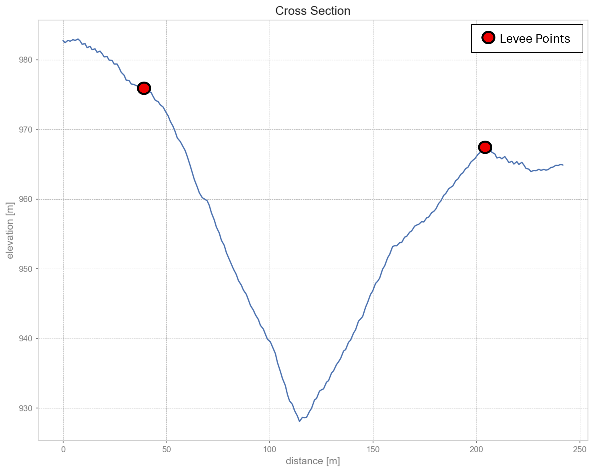

Workflow: in2DFHyd
===================================

This guide describes how to prepare input data and use :py:mod:`in2DFHyd` to
calculate hydraulic initial conditions for a debris-flow simulation with
:py:mod:`c1TIF`.

**Choose your workflow before running the module:**

* **Script-based usage:** Run ``in2DFHyd`` separately, or let ``runC1TIF.py``
  trigger hydraulic preprocessing automatically (``inputHydrograph = True``).
  Follow :ref:`in2dfhyd-script-workflow`.
* **QGIS application:** Run ``in2DFHyd`` first and then ``c1TIF`` as two
  separate QGIS operations. Provide the generated CSV file to ``c1TIF``
  manually and keep ``inputHydrograph = False``. Follow
  :ref:`in2dfhyd-qgis-workflow`.

The input data requirements in :ref:`in2dfhyd-inputs` and the output checks in
:ref:`in2dfhyd-outputs` apply to **both** workflows. The folder structure
described in :ref:`in2dfhyd-inputs` is only required for script-based usage.
QGIS users can load or create the input data directly in their QGIS project.

For details about the underlying methods and configuration parameters, see
:doc:`moduleIn2DFHyd`.

.. note::

   The ``in2DFHyd`` module is still under development. The recommendations
   below reflect the workflow described for the current development stage;
   not all functions have been fully tested.

.. _in2dfhyd-inputs:

1. Prepare the input data
-------------------------

**Script-based usage:** Create a debris-flow process directory with the
following structure::

   NameOfDebrisFlow/
     Inputs/
       <DEMname>.asc or <DEMname>.tif
       HYDR/
         <hydrographName>.csv
       LEVEE/
         <leveePointsName>.shp
       XSECT/
         <crossSectionLineName>.shp

The ``HYDR``, ``LEVEE`` and ``XSECT`` directories contain the discharge
hydrograph, the levee points and the cross section line, respectively.

**QGIS application:** This separate folder structure is **not required**.
Load the DEM and hydrograph directly into the QGIS workflow, and load or
create the cross section line and levee-point layers in your QGIS project.
Select the corresponding inputs in the ``in2DFHyd`` tool interface. The
same input data requirements described below still apply.

The module settings are defined in ``in2DFHydCfg.ini``, or in
``c1TIFCfg.ini`` when the hydraulic preprocessing is initiated through
``c1TIF``. The execution options are described separately in Sections 2 and 3
below. For all module parameters, see :doc:`moduleIn2DFHyd`.

1.1 Digital elevation model (DEM)
~~~~~~~~~~~~~~~~~~~~~~~~~~~~~~~~~

For script-based usage, place the DEM raster in the ``Inputs`` directory;
for QGIS, load the DEM as a raster layer and select it in the tool.
The module supports different raster resolutions. The ``meshCellSize`` parameter
in ``c1TIFCfg.ini`` (2 m by default) determines the cell size used for the simulation.
It is recommended to use the same cell size for the hydraulic preprocessing and the subsequent simulation.
If the input DEM has a different cell size, it is remeshed to the configured ``meshCellSize``
(see [AvaFrame doumentation](https://docs.avaframe.org/en/latest/moduleCom1DFA.html#dem-input-data)).

1.2 Hydrograph
~~~~~~~~~~~~~~

For script-based usage, save the hydrograph as
``Inputs/HYDR/<hydrographName>.csv``. For QGIS, select the hydrograph CSV
directly in the tool interface. The CSV file must
contain exactly two comma-separated columns: ``timestep`` and ``discharge``.

The required units are:

* ``timestep``: time in seconds [s].
* ``discharge``: debris-flow discharge in cubic metres per second [m³/s].

For testing, a time interval of 1 s is recommended. If the module reports
that particles from the previous timestep have not yet left the release
cells, potentially causing numerical instability, increase the hydrograph
time interval.

1.3 Cross section line
~~~~~~~~~~~~~~~~

The cross section line defines the terrain cross section at which the hydrograph
is applied as a boundary condition.

In QGIS, create a **line shapefile** layer. For script-based usage, save it
as ``Inputs/XSECT/<crossSectionLineName>.shp``; for the QGIS application,
use the layer directly in the tool interface. Use the same coordinate reference
system (CRS) as the DEM.
Draw one line across the channel, perpendicular to the expected flow
direction. The line must have **exactly two vertices**: a starting point and
an ending point.

.. figure:: _static/crossSectionLine.png
    :width: 90%

    Cross section line (red) and corresponding starting and ending points

.. important::

   Choosing an appropriate cross section line is the user's responsibility.
   The line must be perpendicular to the flow direction; otherwise,
   plausible simulation results cannot be guaranteed.

1.4 Levee points
~~~~~~~~~~~~~~~~

The two levee points define the lateral extent of the channel. They exclude
low-lying floodplain areas outside the channel from the initial condition.
The discharge prescribed by the hydrograph is therefore initialized only
between the two points.

Create a **point shapefile** layer in QGIS. For script-based usage, save it
as ``Inputs/LEVEE/<leveePointsName>.shp``; for the QGIS application, use
the layer directly in the tool interface.
Use the same CRS as the DEM and the cross section line. The shapefile must contain
**exactly two points**, one on each side of the channel.

    Cross section and corresponding levee points (red)

To select suitable point locations, use the QGIS terrain-profile plugin
``Profile tool``:

#. Draw a profile along the previously defined cross section line.
#. Inspect the DEM elevation profile in the plugin window.
#. Enable the option to display the cursor position.
#. Move the cursor to the desired levee location in the profile. The
   corresponding position is also shown in the main QGIS map window.
#. Place the two levee points at the selected locations.

.. figure:: _static/profileTool.png
    :width: 90%

    Determination of the position of the levee points using ``Profile tool``

The levee points are assigned to the closest cross-section points.

The module also checks whether the channel can accommodate the specified
discharge at each timestep. In the documented implementation, it stops with
an error if the prescribed discharge exceeds the channel's capacity.
Overtopping at the cross section line is not yet supported.

.. _in2dfhyd-script-workflow:

2. Script-based usage
---------------------

Use this section when starting DebrisFrame from Python scripts, **not** from
the QGIS connector. There are two options:

**Option A — Run hydraulic preprocessing separately**

#. Prepare the input files as described in Section 1.
#. Configure ``local_in2DFHydCfg.ini`` for the project (optional).
#. Execute ``runIn2DFHyd.py`` to generate the hydraulic initial conditions.
   See :ref:`moduleIn2DFHyd:To run` and :doc:`scriptBasedUsage`.
#. Check the generated files as described in Section 4.
#. When subsequently running ``c1TIF`` separately, ensure that the generated
   initial-condition CSV is placed in ``Inputs/REL``.

**Option B — Start hydraulic preprocessing automatically from c1TIF**

#. Prepare the same input files as described in Section 1.
#. Set ``inputHydrograph = True`` in ``c1TIFCfg.ini``.
#. Execute ``runC1TIF.py``. The ``c1TIF`` workflow starts ``in2DFHyd``
   preprocessing before the simulation; see
   :ref:`moduleC1TIF:Run from hydrograph` and :doc:`scriptBasedUsage`.
#. Check the generated hydraulic outputs and the simulation results.

.. _in2dfhyd-qgis-workflow:

3. QGIS application
-------------------

Use this section when running the modules through the **QGIS connector**.
Unlike script-based Option B, the hydraulic preprocessing and simulation
must be started **separately and in this order** in the documented version.
See :doc:`qgisConnector` for general connector instructions.

#. Load the DEM and hydrograph, and load or create the cross section line
   and levee-point layers in your QGIS project (Section 1).
#. Run the **in2DFHyd** tool in QGIS to generate the hydraulic initial
   conditions.
#. Check the ``in2DFHyd`` output CSV and plots (Section 4).
#. Open the **c1TIF** tool in QGIS. Select
   ``Outputs/in2DFHyd/<crossSectionName>.csv`` as the input.

.. warning::

   Do not use ``inputHydrograph = True`` to trigger preprocessing when running
   ``c1TIF`` via the QGIS connector. In the documented development version,
   this may cause an error. Instead, execute ``in2DFHyd`` first and pass its
   CSV output explicitly to ``c1TIF`` as described above.

.. _in2dfhyd-outputs:

4. Check the output data (both workflows)
------------------------

The ``in2DFHyd`` outputs are organized as follows::

   NameOfDebrisFlow/
     Outputs/
       in2DFHyd/
         <crossSectionName>.csv                         (named after the XSECT shapefile)
         <crossSectionName>_crossSectionCells.csv       (optional)
         Plots/
           <crossSectionName>_crossSection.png
           <crossSectionName>_ratingCurve.png

For more detail on each output, see :ref:`moduleIn2DFHyd:Output`.

``<crossSectionName>.csv``
   Contains the spatially distributed initial hydraulic conditions used by
   ``c1TIF``. Depending on the execution method, the file may be transferred
   automatically to ``Inputs/REL`` or may need to be supplied manually.
   Before starting the simulation, verify that the file is available to
   ``c1TIF``.

``<crossSectionName>_crossSectionCells.csv``
   Contains the coordinates and elevations of cell centres mapped along the
   cross section line. It is written if ``exportCrossSectionCells = True``.
   Load these coordinates into QGIS to check whether the cross section line was
   represented correctly on the model grid.

``<crossSectionName>_crossSection.png``
   Shows the terrain cross section and the levee-point positions. Use it to
   verify that the channel geometry and lateral boundaries are plausible.

``<crossSectionName>_ratingCurve.png``
   Shows the cross-sectional geometry and the relationship between flow area
   and flow thickness. Use it to check the hydraulic plausibility of the
   derived initial conditions.

5. Troubleshooting checklist
----------------------------

If the preprocessing or subsequent simulation fails, check the following:

* **Script-based usage:** Are the project directory and the subdirectories
  named correctly?
* **QGIS application:** Are all required input files or layers loaded or
  created in the QGIS project and selected in the tool interface?
* Do the DEM, cross section line and levee points use the same CRS?
* Does the cross section line contain exactly two vertices and run across the
  channel, perpendicular to the expected flow direction?
* Does the levee-point shapefile contain exactly two points? Are they
  correctly positioned?
* Do the hydrograph columns, units and timestep interval match the required
  format?
* Are the output plots plausible? They may help explain errors that are
  difficult to interpret from error messages alone.
* **Script-based integrated preprocessing:** Is ``inputHydrograph = True``
  set in ``c1TIFCfg.ini``?
* **QGIS application:** Was ``in2DFHyd`` run first, is
  ``inputHydrograph = False``, and was the generated CSV explicitly selected
  as the time-dependent release input for ``c1TIF``?
* **Separate script-based runs:** Is the generated initial-condition CSV
  available to ``c1TIF`` (for example in ``Inputs/REL`` where applicable)?
* If cross section-line or levee-point errors persist despite the checks above,
  try deleting and redrawing the corresponding line or points in QGIS.
* Does the hydrograph discharge remain within the capacity of the channel?
  The documented implementation does not allow overtopping at the release
  line.

