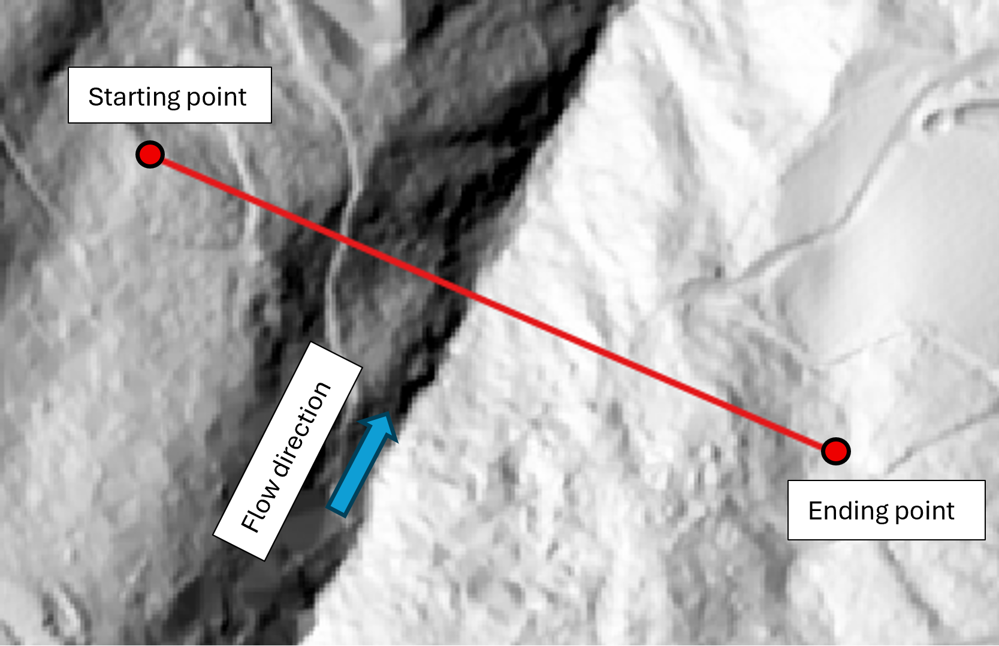
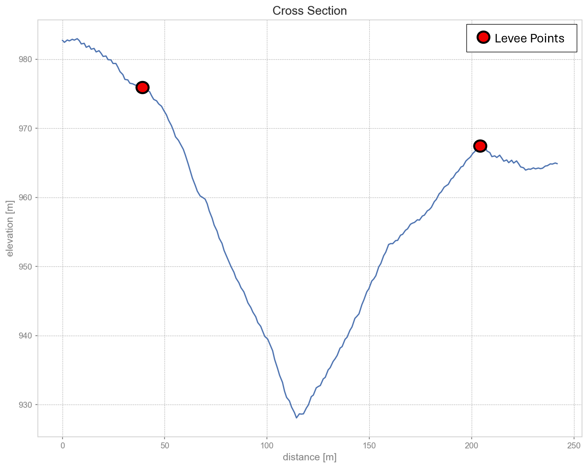
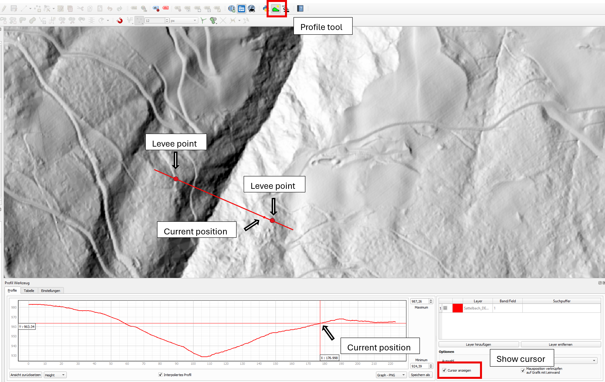

Workflow: in2DFHyd
===================================

This guide provides a step-by-step workflow for preparing input data and using
:py:mod:`in2DFHyd` to derive hydraulic initial conditions for a debris-flow
simulation with :py:mod:`c1TIF`.

For detailed information about the underlying methods and all available
configuration options, see :doc:`moduleIn2DFHyd`.

.. note::

   The ``in2DFHyd`` module is still under development. The recommendations
   below reflect the workflow described for the current development stage;
   not all functions have been fully tested.

1. Prepare the input data
-------------------------

Create a debris-flow process directory with the following structure::

   NameOfDebrisFlow/
     Inputs/
       <DEMname>.asc or <DEMname>.tif
       HYDR/
         <hydrographName>.csv
       LEVEE/
         <leveePointsName>.shp
       XSECT/
         <crossSectionLineName>.shp

The ``HYDR``, ``LEVEE`` and ``XSECT`` directories contain the discharge
hydrograph, the levee points and the cross section line, respectively.

The module settings are defined in ``in2DFHydCfg.ini``, or in
``c1TIFCfg.ini`` when the hydraulic preprocessing is initiated through
``c1TIF``. See :doc:`moduleIn2DFHyd` for the complete configuration description.

1.1 Digital elevation model (DEM)
~~~~~~~~~~~~~~~~~~~~~~~~~~~~~~~~~

Place the DEM raster in the ``Inputs`` directory. The module supports different raster resolutions.
The ``meshCellSize`` parameter in ``c1TIFCfg.ini`` (2 m by default) determines
the cell size used for the simulation. It is recommended to use the same cell
size for the hydraulic preprocessing and the subsequent simulation. If the
input DEM has a different cell size, it is remeshed to the configured ``meshCellSize``.

1.2 Hydrograph
~~~~~~~~~~~~~~

Save the hydrograph as a CSV file in ``Inputs/HYDR/<hydrographName>.csv``. It must contain exactly
the two columns ``timestep`` and ``discharge``. The separator of the CSV-file 
is a comma ``,``.

The required units are:

* ``timestep``: time in seconds [s].
* ``discharge``: debris-flow discharge in cubic metres per second [m³/s].

For testing, a time interval of 1 s is recommended. If the module reports
that particles from the previous timestep have not yet left the release
cells, potentially causing numerical instability, increase the hydrograph
time interval.

1.3 Cross section line
~~~~~~~~~~~~~~~~

The cross section line defines the terrain cross section at which the hydrograph
is applied as a boundary condition.

In QGIS, create a new **line shapefile** layer and save it in ``Inputs/XSECT/<crossSectionLineName>.shp``.
Ensure that it uses the same coordinate reference system (CRS) as the DEM.
Draw one line across the channel, perpendicular to the expected flow
direction. The line must have **exactly two vertices**: a starting point and
an ending point.

    Cross section line (red) and corresponding starting and ending points

.. important::

   Choosing an appropriate cross section line is the user's responsibility.
   The line must be perpendicular to the flow direction; otherwise,
   plausible simulation results cannot be guaranteed.

1.4 Levee points
~~~~~~~~~~~~~~~~

The two levee points define the lateral extent of the channel. They exclude
low-lying floodplain areas outside the channel from the initial condition.
The discharge prescribed by the hydrograph is therefore initialized only
between the two points.

Create a **point shapefile** layer in QGIS and save it in ``Inputs/LEVEE/<leveePointsName>.shp``.
Use the same CRS as the DEM and the cross section line. The shapefile must contain
**exactly two points**, one on each side of the channel.

    Cross section and corresponding levee points (red)

To select suitable point locations, use the QGIS terrain-profile plugin
``Profile tool``:

#. Draw a profile along the previously defined cross section line.
#. Inspect the DEM elevation profile in the plugin window.
#. Enable the option to display the cursor position.
#. Move the cursor to the desired levee location in the profile. The
   corresponding position is also shown in the main QGIS map window.
#. Place the two levee points at the selected locations.

    Determination of the position of the levee points using ``Profile tool``

Leave sufficient distance between the levee points and the starting and
ending points of the cross section line. The module reports an error if this
requirement is not met.

The module also checks whether the channel can accommodate the specified
discharge at each timestep. In the documented implementation, it stops with
an error if the prescribed discharge exceeds the channel's capacity.
Overtopping at the cross section line is not yet supported.

2. Run the module
----------------

There are two script-based options for running ``in2DFHyd``:

* **Standalone preprocessing:** Run ``runIn2DFHyd.py`` to calculate the
  hydraulic initial conditions independently of ``c1TIF``.
  See :ref:`moduleIn2DFHyd:To run`.
* **Preprocessing as part of the simulation:** Set
  ``inputHydrograph = True`` in ``c1TIFCfg.ini`` and execute ``runC1TIF.py``.
  This starts the hydrograph preprocessing automatically.
  See :ref:`moduleC1TIF:Run from hydrograph`.

Application via QGIS
~~~~~~~~~~~~~~~~~~~~

For general instructions on using the QGIS connector, see
:doc:`qgisConnector`.

Run the ``in2DFHyd`` and ``c1TIF`` QGIS functions
**sequentially**. First calculate the initial conditions with ``in2DFHyd``.
Then provide ``Outputs/in2DFHyd/<crossSectionName>.csv`` as the
*Time dependent release values / release geometry* input of ``c1TIF``.

.. warning::

   When using the QGIS connector, leave ``inputHydrograph = False`` in
   ``c1TIFCfg.ini``. In the documented development version, enabling this
   parameter in the QGIS workflow may cause an error. Instead, run both
   tools separately as described above.

3. Check the output data
------------------------

The ``in2DFHyd`` outputs are organized as follows::

   NameOfDebrisFlow/
     Outputs/
       in2DFHyd/
         <crossSectionName>.csv                         (named after the XSECT shapefile)
         <crossSectionName>_crossSectionCells.csv       (optional)
         Plots/
           <crossSectionName>_crossSection.png
           <crossSectionName>_ratingCurve.png

For more detail on each output, see :ref:`moduleIn2DFHyd:Output`.

``<crossSectionName>.csv``
   Contains the spatially distributed initial hydraulic conditions used by
   ``c1TIF``. Depending on the execution method, the file may be transferred
   automatically to ``Inputs/REL`` or may need to be supplied manually.
   Before starting the simulation, verify that the file is available to
   ``c1TIF``.

``<crossSectionName>_crossSectionCells.csv``
   Contains the coordinates and elevations of cell centres mapped along the
   cross section line. It is written if ``exportCrossSectionCells = True``.
   Load these coordinates into QGIS to check whether the cross section line was
   represented correctly on the model grid.

``<crossSectionName>_crossSection.png``
   Shows the terrain cross section and the levee-point positions. Use it to
   verify that the channel geometry and lateral boundaries are plausible.

``<crossSectionName>_ratingCurve.png``
   Shows the cross-sectional geometry and the relationship between flow area
   and flow thickness. Use it to check the hydraulic plausibility of the
   derived initial conditions.

4. Troubleshooting checklist
----------------------------

If the preprocessing or subsequent simulation fails, check the following:

* Are the project directory and all input subdirectories named correctly?
* Do the DEM, cross section line and levee points use the same CRS?
* Does the cross section line contain exactly two vertices and run across the
  channel, perpendicular to the expected flow direction?
* Does the levee-point shapefile contain exactly two points? Are they
  correctly positioned and sufficiently far from the release-line endpoints?
* Do the hydrograph columns, units and timestep interval match the required
  format?
* Are the output plots plausible? They may help explain errors that are
  difficult to interpret from error messages alone.
* If running ``c1TIF`` with a hydrograph, is ``initCondHyd.csv`` available
  as the required time-dependent release input (or in ``Inputs/REL``, where
  applicable)?
* If cross section-line or levee-point errors persist despite the checks above,
  try deleting and redrawing the corresponding line or points in QGIS.
* Does the hydrograph discharge remain within the capacity of the channel?
  The documented implementation does not allow overtopping at the release
  line.

